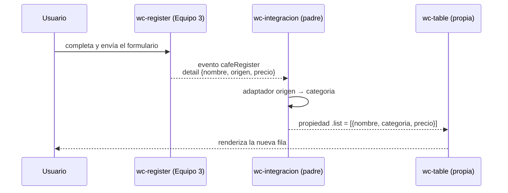

# Integración de `<wc-register>` (Equipo 3) con `<wc-table>`

## 1. Datos

- **Equipo local:** Tienda de Bebidas
- **Integrantes:** José María Sandoval (Rol 1), Ian Escobar (Rol 2), Diego Alcaciega (Rol 3 y 4)
- **Equipo externo:** Equipo 3 · Café Raíz
- **Repositorio externo:** <https://github.com/Shairr/Componentes-Lit-G3>
- **Archivo externo:** `src/views/home/register.js` → copiado en `src/externos/equipo-3/register.js`
- **Commit usado:** `c9909e4`

## 2. Componentes y roles

| Componente | Archivo | Origen | Rol |
|---|---|---|---|
| `<wc-integracion>` | `src/view/integracion/integracion.js` | Nuestro equipo | Padre. Dueño del estado `lista`. |
| `<wc-register>` | `src/externos/equipo-3/register.js` | Equipo 3 | Hijo. Emite el evento `cafeRegister`. |
| `<wc-table>` | `src/view/home/table.js` | Nuestro equipo | Hijo. Recibe la lista por la propiedad `.list`. |

## 3. Flujo de comunicación

El evento que sube es `cafeRegister` con `detail: { nombre, origen, precio }`, y la propiedad que baja es `.list`.

**Adaptador:** `nombre` → `nombre`, `origen` → `categoria` (como “Café de …”), `precio` → `precio` (convertido a número). La conversión se hace en el padre, sin modificar el componente externo.

## 4. Dificultades

| Integrante | Síntoma | Causa | Solución |
|---|---|---|---|
| José María Sandoval | En la terminal salía `git: CommandNotFoundException`. | Git no estaba instalado; VS Code no lo trae incluido. | Instalé Git for Windows y reinicié VS Code. |
| José María Sandoval | La tabla mostraba bebidas y el formulario externo mandaba cafés con `origen`, campo que la tabla no tiene. | Los dos equipos usan formatos de datos distintos. | En el padre, el adaptador convierte `origen` en `categoria` sin tocar el componente externo. |
| José María Sandoval | Las rutas del enunciado (`src/views/`) no coincidían con nuestro proyecto. | Nuestro proyecto usa `src/view/` en singular. | Creé la integración en `src/view/integracion/` y ajusté los imports. |
| Ian Escobar | Al probar la carga inicial de `integracion.html`, la tabla podía fallar si no había datos. | `<wc-table>` ejecuta `this.list.map(...)`; si la propiedad llega como `undefined`, arroja un error en tiempo de ejecución. | Se verificó que `<wc-integracion>` inicialice siempre `this.lista = []` en el constructor. |
| Ian Escobar | El precio ingresado en el formulario externo requería asegurar su tipo antes de la tabla. | El formulario emite el valor numérico pero con formateo previo a decimales, susceptible a discrepancias de tipo de dato. | En el método adaptador `agregar(event)` se aseguró la conversión con `Number(event.detail.precio)` para garantizar operaciones seguras. |
| Diego Alcaciega | La etiqueta `<wc-register>` y el evento `cafeRegister` diferían de las convenciones del enunciado (`<wc-form-register>` y `personRegister`). | El Equipo 3 adaptó su nomenclatura al contexto de su negocio ("Café Raíz") y no disponía de documentación JSDoc explicativa. | Se revisó a fondo el código fuente en `src/externos/equipo-3/register.js` para extraer el nombre exacto del evento y los atributos del `detail`. |
| Diego Alcaciega | Se debía validar que el evento del formulario externo pudiera ser detectado por el padre fuera de su Shadow DOM. | En Web Components, los eventos dentro del Shadow DOM no cruzan al DOM superior a menos que `composed` esté explícitamente en `true`. | Se comprobó en la línea 175 de `register.js` que el Equipo 3 incluyó `bubbles: true` y `composed: true`, garantizando la captura en `<wc-integracion>`. |

## 5. Evaluación del componente externo

Evaluación técnica realizada por Diego Alcaciega (Rol 3) sobre el componente `<wc-register>` (Equipo 3 · Café Raíz, commit `c9909e4`):

| Aspecto | Nota (0-5) | Evidencia técnica |
|---|:---:|---|
| **API clara** | 4/5 | El evento emitido (`cafeRegister`) y su `detail` (`nombre`, `origen`, `precio`) son autoexplicativos. Sin embargo, la etiqueta registrada es `<wc-register>` en lugar de un nombre más específico como `<wc-cafe-register>`, y no incluye documentación JSDoc que describa el contrato del evento sin inspeccionar el código. |
| **Evento bien construido** | 5/5 | Construye el evento con `new CustomEvent("cafeRegister", { detail: data, bubbles: true, composed: true })`. Los flags `bubbles: true` y especialmente `composed: true` son indispensables y están correctamente implementados para que el evento escape del Shadow DOM y pueda ser escuchado por el padre `<wc-integracion>`. |
| **Robustez** | 4/5 | Cuenta con validaciones nativas de HTML5 (`required`, `type="number"`, `min="0"`, `step="0.01"`). Formatea el precio a 2 decimales con `@blur`. Como debilidad, no limpia los campos del formulario tras la emisión (`this.nombre = ""`, etc.), requiriendo que el usuario borre los datos a mano para registrar otro café. |
| **Encapsulamiento** | 5/5 | Excelente encapsulamiento mediante Shadow DOM y tag `css`. Los selectores (`:host`, `form`, `.campo`, etc.) no colisionan con los estilos globales ni con los de nuestra tabla. Hace uso de variables CSS con valores de respaldo (`var(--color-marca, #6f4e37)`), facilitando la integración visual. |
| **Reutilización** | 5/5 | Se integró de manera modular copiando únicamente `src/externos/equipo-3/register.js` sin alterar una sola línea de su código fuente ni requerir archivos auxiliares de su repositorio. |

## 6. Uso de IA

| Herramienta | Quién la usó | Para qué | Qué cambiamos |
|---|---|---|---|
| Claude | José María Sandoval | Guía para Git y GitHub, revisar el componente del equipo 3, generar el padre y probarlo. | Se revisó la propuesta y se ajustaron el adaptador y las rutas; el componente externo se mantuvo sin cambios. |
| ChatGPT / Asistente IA | Ian Escobar | Estructuración del archivo de pruebas aislado `integracion.html` y validación de escenarios con lista vacía. | Se aseguró que `integracion.html` prescinda totalmente de componentes de navegación incompletos (`<wc-navbar>`). |
| Gemini / Asistente IA | Diego Alcaciega | Redacción de la matriz de evaluación técnica de Web Components, diagramación Mermaid del flujo de comunicación y redacción de dificultades y aportes. | Se verificaron las referencias a líneas exactas del código del Equipo 3, se ajustó la redacción técnica y se consolidó el documento final. |

## 7. Aportes del equipo

| Integrante | Usuario | Rol | Qué hizo | Commits |
|---|---|---|---|---|
| José María Sandoval | @Josema-53 | Rol 1 · Integración | Creó el repositorio y la rama `taller-integracion`, fijó el commit `c9909e4`, copió el componente externo sin alteraciones, programó el padre `<wc-integracion>` con el patrón Adaptador y abrió el PR. | [Commits de Josema-53](https://github.com/Josema-53/app-lit/commits/taller-integracion?author=Josema-53) |
| Ian Escobar | @IanEsco632 | Rol 2 · Adaptador y pruebas | Creó `integracion.html` aislado de la barra de navegación, realizó pruebas de flujo con lista vacía y registro de datos, y generó la captura con consola limpia (`Taller_Equipo_N.png`). | [Commits de Ian](https://github.com/Josema-53/app-lit/commits/taller-integracion?author=IanEsco632) |
| Diego Alcaciega | @Ultimate | Rol 3 y 4 · Revisión y documentación | Evaluó la API, robustez, eventos y Shadow DOM del Equipo 3, redactó el issue para su repositorio, elaboró el diagrama Mermaid de comunicación y documentó el reporte completo en `integracion.md`. | [Commits de Diego](https://github.com/Josema-53/app-lit/commits/taller-integracion?author=Ultimate) |

## 8. Evidencias de pruebas y conclusiones

### Resultados de la prueba funcional
Se verificó el funcionamiento integral en `http://localhost:5173/integracion.html`:
1. **Carga inicial:** La tabla maneja la lista vacía sin arrojar excepciones en consola (`this.lista = []`).
2. **Envío del formulario:** Se ingresaron los datos de prueba (`Nombre: "Café artesanal"`, `Región: "Loja"`, `Precio: 3.50`).
3. **Adaptación de datos:** El componente padre `<wc-integracion>` capturó el evento `cafeRegister` y transformó el origen en la categoría `"Café de Loja"`, forzando el precio a tipo `Number`.
4. **Renderizado en la tabla:** `<wc-table>` detectó la actualización inmutable de la propiedad `.list` y renderizó la nueva fila de inmediato (`$3.50`).
5. **Consola del navegador:** Sin errores de JavaScript ni advertencias de Shadow DOM, mostrando únicamente el mensaje estándar de Lit en modo desarrollo.

### Conclusiones
- **Desacoplamiento efectivo:** Se comprobó que el estándar de Web Components y la reactividad de Lit permiten integrar módulos desarrollados por equipos independientes sin compartir estado global ni dependencias cruzadas.
- **Patrón Adaptador:** La capa de adaptación en el componente padre es la solución ideal para conciliar diferencias entre esquemas de datos sin violar el principio de no modificar código externo.
- **Encapsulamiento visual:** A pesar de que el formulario y la tabla poseen temas y paletas cromáticas contrastantes (tonos café vs. tonos verdes), el Shadow DOM garantizó que ninguna regla CSS interfiriera entre ambos componentes.

## 9. Enlaces de entrega y trazabilidad

- **Componente padre integrador:** [`src/view/integracion/integracion.js`](https://github.com/Josema-53/app-lit/blob/taller-integracion/src/view/integracion/integracion.js)
- **Pull Request de integración:** <https://github.com/Josema-53/app-lit/pull/1>
- **Issue abierto en el repositorio externo:** <https://github.com/Shairr/Componentes-Lit-G3/issues> (reporte de evaluación y mejoras por Rol 3)
