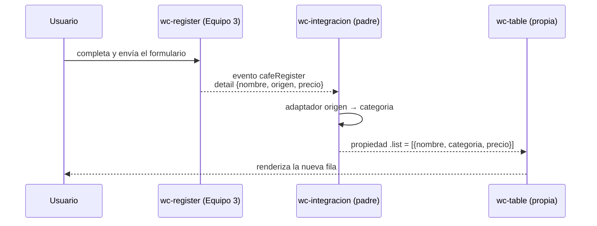

# Integración de `<wc-register>` (Equipo 3) con `<wc-table>`

## 1. Datos

- **Equipo externo:** Equipo 3 · Café Raíz
- **Repositorio externo:** <https://github.com/Shairr/Componentes-Lit-G3>
- **Archivo externo:** `src/views/home/register.js` → copiado en `src/externos/equipo-3/register.js`
- **Commit usado:** `c9909e4`

## 2. Componentes y roles

| Componente | Archivo | Origen | Rol |
|---|---|---|---|
| `<wc-integracion>` | `src/view/integracion/integracion.js` | Nuestro equipo | Padre. Dueño del estado `lista`. |
| `<wc-register>` | `src/externos/equipo-3/register.js` | Equipo 3 | Hijo. Emite el evento `cafeRegister`. |
| `<wc-table>` | `src/view/home/table.js` | Nuestro equipo | Hijo. Recibe la lista por la propiedad `.list`. |

## 3. Flujo de comunicación

El evento que sube es `cafeRegister` con `detail: { nombre, origen, precio }`, y la propiedad que baja es `.list`.

**Adaptador:** `nombre` → `nombre`, `origen` → `categoria` (como “Café de …”), `precio` → `precio` (convertido a número). La conversión se hace en el padre, sin modificar el componente externo.

## 4. Dificultades

| Integrante | Síntoma | Causa | Solución |
|---|---|---|---|
| José María Sandoval | En la terminal salía `git: CommandNotFoundException`. | Git no estaba instalado; VS Code no lo trae incluido. | Instalé Git for Windows y reinicié VS Code. |
| José María Sandoval | La tabla mostraba bebidas y el formulario externo mandaba cafés con `origen`, campo que la tabla no tiene. | Los dos equipos usan formatos de datos distintos. | En el padre, el adaptador convierte `origen` en `categoria` sin tocar el componente externo. |
| José María Sandoval | Las rutas del enunciado (`src/views/`) no coincidían con nuestro proyecto. | Nuestro proyecto usa `src/view/` en singular. | Creé la integración en `src/view/integracion/` y ajusté los imports. |

## 5. Evaluación del componente externo

Evaluación técnica del componente `<wc-register>` (Equipo 3 · Café Raíz) sobre el commit `c9909e4`:

| Aspecto | Nota (0-5) | Evidencia técnica |
|---|:---:|---|
| **API clara** | 4/5 | El evento emitido (`cafeRegister`) y su `detail` (`nombre`, `origen`, `precio`) son autoexplicativos. Sin embargo, la etiqueta registrada es `<wc-register>` en lugar de un nombre más específico como `<wc-cafe-register>`, y no incluye documentación JSDoc que describa el contrato del evento sin inspeccionar el código. |
| **Evento bien construido** | 5/5 | Construye el evento con `new CustomEvent("cafeRegister", { detail: data, bubbles: true, composed: true })`. Los flags `bubbles: true` y especialmente `composed: true` son indispensables y están correctamente implementados para que el evento escape del Shadow DOM y pueda ser escuchado por el padre `<wc-integracion>`. |
| **Robustez** | 4/5 | Cuenta con validaciones nativas de HTML5 (`required`, `type="number"`, `min="0"`, `step="0.01"`). Formatea el precio a 2 decimales con `@blur`. Como debilidad, no limpia los campos del formulario tras la emisión (`this.nombre = ""`, etc.), requiriendo que el usuario borre los datos a mano para registrar otro café. |
| **Encapsulamiento** | 5/5 | Excelente encapsulamiento mediante Shadow DOM y tag `css`. Los selectores (`:host`, `form`, `.campo`, etc.) no colisionan con los estilos globales ni con los de nuestra tabla. Hace uso de variables CSS con valores de respaldo (`var(--color-marca, #6f4e37)`), facilitando la integración visual. |
| **Reutilización** | 5/5 | Se integró de manera modular copiando únicamente `src/externos/equipo-3/register.js` sin alterar una sola línea de su código fuente ni requerir archivos auxiliares de su repositorio. |

## 6. Uso de IA

| Herramienta | Quién la usó | Para qué | Qué cambiamos |
|---|---|---|---|
| Claude | José María Sandoval | Guía para Git y GitHub, revisar el componente del equipo 3, generar el padre y probarlo. | Se revisó la propuesta y se ajustaron el adaptador y las rutas; el componente externo se mantuvo sin cambios. |

## 7. Aportes del equipo

| Integrante | Usuario | Rol | Qué hizo | Commits |
|---|---|---|---|---|
| José María Sandoval | @Josema-53 | Rol 1 · Integración | Creó el repositorio y la rama, fijó el commit `c9909e4`, copió el formulario sin cambios, `<wc-integracion>` y abrió el PR: <https://github.com/Josema-53/app-lit/pull/1> | <https://github.com/Josema-53/app-lit/commits/taller-integracion?author=Josema-53> |

